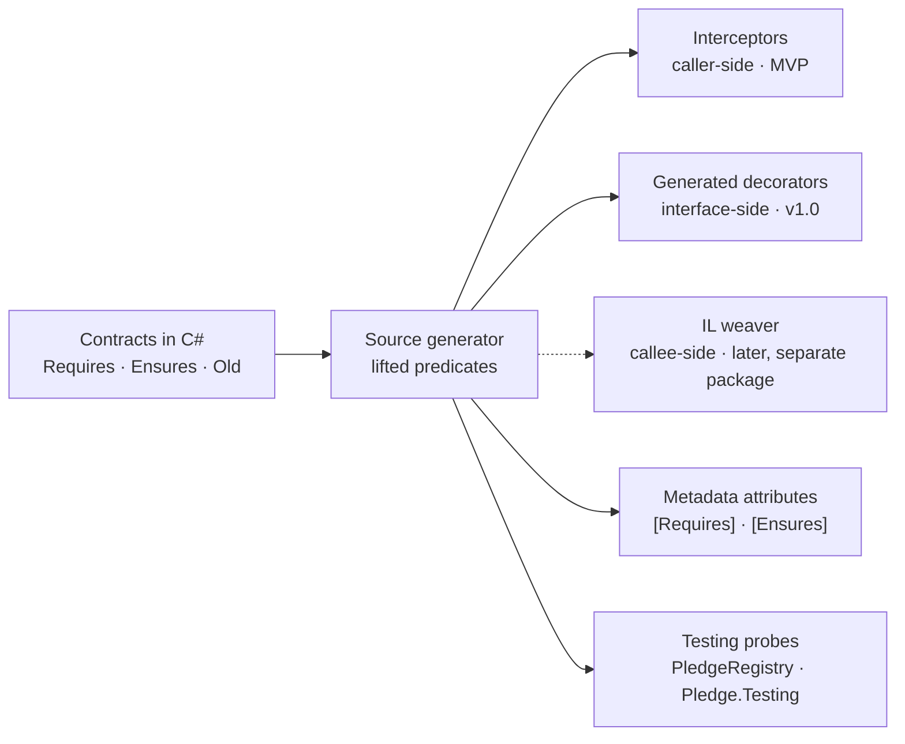

# Pledge — Design by Contract for .NET: Design

Oct 29, 2026 · @Page

## Thesis

Pledge is a free, MIT-licensed Design-by-Contract library for modern .NET that gives C# real postconditions, `old()` snapshots, invariants and contract inheritance, written as ordinary C# and executed by a Roslyn source generator — no IL rewriter, no compiler fork, no Visual Studio extension required.

**Who it is for.** Teams writing C# where a wrong result costs more than a slow build: finance, healthcare, defense, infrastructure libraries, and anyone reviewing AI-generated code who wants machine-checkable statements of what a method must do.

**Why it should exist.** .NET had this (Code Contracts, 2008–2017) and lost it to a brittle mechanism, not to a lack of demand. C++26 just standardized contracts (March 2026) with a design .NET can borrow wholesale. The only living .NET option, Metalama.Patterns.Contracts, covers value constraints (`[NotNull]`, `[Range]`) but not relational postconditions, and runs on a Roslyn fork. Nothing since `ccrewrite` lets a C# developer write `Ensures(Balance == Old(Balance) - amount)` and have it checked.

**What it is not.** It is not an input-validation framework. Contract violations are bugs with blame attached (caller or callee); validation failures are expected runtime conditions. FluentValidation, DataAnnotations and guard clauses keep their jobs.

## Design principles

Every principle below is the inverse of a specific way Code Contracts died or a specific objection teams raise to Metalama.

1. **Pure Roslyn, no IL, no fork.** Source generators, interceptors and analyzers only. No post-build rewriter in the critical path, no custom compiler. If a future C# version breaks something, it breaks a generator, which is a package update, not a toolchain migration.
2. **Source is the single truth.** Contracts are written as C# in the method they describe. The generator derives everything else — runtime checks, metadata attributes, test oracles, docs — from that one place. Nothing is authored twice.
3. **Degrade safely, never silently lie.** If the generator is absent, contract calls compile to no-ops and an analyzer warning says so. The `Contract.Requires` booby trap (process terminates asking for a rewriter that doesn't support your runtime) must be impossible to reproduce.
4. **Zero cost when off.** In `Ignore` mode the generator emits nothing and the no-op calls are removed by `[Conditional]`. Release builds pay nothing unless the team opts in.
5. **NativeAOT and trimming safe.** No reflection, no `Expression<T>` compilation, no runtime code generation. Everything the checks need is emitted at compile time.
6. **Contracts are not validation.** A violation is a bug with blame: `PreconditionViolationException` blames the caller, `PostconditionViolationException` and `InvariantViolationException` blame the callee. The exception types, messages and docs say so. The library never positions itself against FluentValidation.
7. **Borrow C++26's vocabulary, not Code Contracts' reputation.** Enforcement modes are ignore / observe / enforce. The package and its static class are not named "Code Contracts" and do not live in `System.Diagnostics.Contracts`, so the two can coexist and search results don't inherit the old project's obituaries.
8. **Stay close to the language proposal.** Where csharplang #105 and C++26 agree on a semantic (fail-fast vs throw is configurable; `old()` is explicit; postconditions see the result), follow them. If Microsoft ever ships contracts, migration should be mechanical.
9. **No telemetry, no phone-home, no sponsorship nag in the build.** MIT, forever. The Moq lesson is permanent in this ecosystem.
10. **One install, no setup.** `dotnet add package` wires `InterceptorsNamespaces` through build props; an analyzer with a code fix catches the one case where it can't.

## Authoring model

Contracts are ordinary C# calls at the top of the method body; the IDE, compiler and refactoring tools treat them as code, and the generator lifts them out at build time.

```csharp
public decimal Withdraw(decimal amount)
{
    Pledge.Requires(amount > 0);
    Pledge.Requires(amount <= Balance, "insufficient funds");
    Pledge.Ensures(Balance == Pledge.Old(Balance) - amount);
    Pledge.Ensures(Pledge.Result<decimal>() >= 0);
    Pledge.EnsuresOnThrow<InvalidOperationException>(Balance == Pledge.Old(Balance));

    Balance -= amount;
    return Balance;
}

// v1.0: object invariants
[Invariant]
private void BalanceNeverNegative() => Pledge.Invariant(Balance >= 0);
```

**Placement rules (enforced by analyzer):**

- Pledge calls must be the first statements of the body, before any other code. Anything after the first non-contract statement is a diagnostic, not silently ignored.
- `Requires` before `Ensures` before `EnsuresOnThrow`, by convention. The generator accepts any order; a reordering fix is not in MVP (Oct 29, 2026).
- Contract expressions must be pure: no assignments, no `await`, no calls to methods not marked `[Pure]` or known-pure BCL members. Violations are a warning in MVP, an error in v1.0. Property and field reads are taken as pure, operators and the members of `object` and the comparison interfaces too; the BCL allow-list covers `System.Linq`, `System.Numerics`, the immutable and frozen collections, `Math`, `string`, the primitives, dates and the query-shaped members of the collections (`Contains`, `TryGetValue`, `IndexOf`, ...). Everything else needs `[Pure]`, and the fix adds it.
- Supported targets in MVP: instance and static methods (sync and `async Task` / `Task<T>` / `ValueTask` / `ValueTask<T>`). Property accessors are not invocations, so interceptors cannot reach them (found Oct 29, 2026); contracts on properties arrive with decorator mode in v1.0, and until then the generator reports PLEDGE009 on them. Constructors, iterators, local functions, lambdas and `ref` returns are v1.0 or later.

**Interface and abstract contracts (v1.0).** Interface members have no body, so their contracts live in a sibling class marked `[PledgeFor(typeof(IAccount))]` with mirroring signatures, following the Code Contracts and csharplang #105 pattern. Implementations inherit them automatically in decorator mode.

**Why calls and not attributes.** Attributes cannot carry lambdas or reference locals, which is why Metalama's vocabulary is limited to fixed predicates. Calls get full language support for free. The generator also emits attribute metadata (see Metadata and documentation) so the declarative view exists for consumers without the authoring cost.

## Execution model

One authoring model, three execution strategies; the MVP ships the first, v1.0 adds the second, and the third stays an opt-in package that the core never depends on.



The generator is the only component that turns contracts into code; every path and side output it feeds is derived from the same lifted predicates, so the three execution paths and the test bridge can never disagree about what a contract says.

| Strategy | How checks run | Covers | Does not cover | Ships in |
| --- | --- | --- | --- | --- |
| **Interceptors** (caller-side) | Generator emits a checked shadow method per contracted method and an `[InterceptsLocation]` for every call site in the compilation; the callee is untouched | All direct calls inside the compiling assembly; async via `await` in the wrapper | Delegates, reflection, calls from other assemblies, virtual dispatch to a derived override | MVP |
| **Generated decorators** (interface-side) | For each contracted interface or `[Pledged]` class, generate `Foo__Pledged : IFoo` wrapping every member; register as a DI decorator | Everything behind an interface, across assemblies; contract inheritance; invariants | Concrete types not behind an interface | v1.0 |
| **IL weaver** (callee-side, optional) | Separate Fody add-in injecting prologue/epilogue into the method itself | Every caller, including ones you never compile | Adds a build-time weaving step; the one road that has died before | Later, separate package |

**Generated code shape (interceptor mode, sync).** One file-local class per contracted method: a shared `__Checked` body that evaluates the contracts and then calls the original, plus a one-line interceptor stub per call site. The stub's `#line` directive maps it onto the caller's line, so `[CallerFilePath]`/`[CallerLineNumber]` on `__Checked` receive the real call site without a wrapper per call site. `#line` directives inside `__Checked` point each check at the contract's own line, so a stack trace and the debugger land on `Pledge.Requires(...)`, not on generated code. A contract expression that throws is reported as a violation with the exception as `Cause`.

```csharp
// <auto-generated/>
namespace PledgeContracts.Generated
{
    file static class Account_Withdraw_94ebe2a8
    {
        [DebuggerStepThrough]
        [InterceptsLocation(1, "...")]
        public static decimal __Intercept0(this global::Bank.Account @this, decimal amount)
        {
#line 42 "/src/Program.cs"
            return __Checked(@this, amount);
#line default
        }

        private static decimal __Checked(global::Bank.Account @this, decimal amount,
            [CallerFilePath] string __callerFilePath = "", [CallerLineNumber] int __callerLineNumber = 0)
        {
            bool __pledgeOk0;
            try
            {
#line 11 "/src/Account.cs"
                __pledgeOk0 = (amount > 0);
#line default
            }
            catch (Exception __pledgeCause) { PledgeRuntime.Enforce(new PledgeViolation { ..., Cause = __pledgeCause }); __pledgeOk0 = true; }

            if (!__pledgeOk0)
            {
#line 11 "/src/Account.cs"
                PledgeRuntime.Enforce(new PledgeViolation
                {
                    Kind = PledgeKind.Precondition, Expression = "amount > 0", Member = "Account.Withdraw",
                    CallerFilePath = __callerFilePath, CallerLineNumber = __callerLineNumber,
                });
#line default
            }
            // ... one block per contract, then:
            return @this.Withdraw(amount);
        }
    }
}
```

`PledgeRuntime.Enforce` is `Observe` or `EnforceFailFast` in those modes; the mode is a build-time choice, so the runtime holds no mode state. Instance members in a contract are rewritten to `@this.Member`, static members and types are spelled out with `global::`, and the author's usings are re-imported, resolved, into the generated file. Because the check runs outside the type, a contract may only reference members visible outside it; private and protected members are reported (PLEDGE009), which is also the right rule for preconditions a caller is expected to satisfy. The body's original `Pledge.*` calls remain in source and compile away (`[Conditional("PLEDGE_NEVER")]`), so the intercepted callee carries no checks and no cost.

**Enforcement modes** — an MSBuild property, defaulting to `Enforce` in Debug and `Ignore` in Release, overridable per project and per kind. The package's `Pledge.targets` picks the default, hands the value to the generator as a compiler-visible property and fails the build on a value outside the set, so a typo never silently ignores contracts:

| Mode | Behavior | Cost | C++26 equivalent |
| --- | --- | --- | --- |
| `Ignore` | Generator emits no wrappers and, unless `PledgeRegistry` is set, no testing probes; calls compile away (metadata attributes still emitted unless `PledgeMetadata` is `false`) | Zero | ignore |
| `Observe` | Checks run; violations go to `PledgeRuntime.ViolationHandler` and execution continues | Checks + handler | observe |
| `Enforce` | Checks run; violations throw the kind-specific exception | Checks | enforce |
| `EnforceFailFast` | Checks run; violations call `Environment.FailFast` after the handler | Checks | quick-enforce |

```xml
<PropertyGroup>
  <PledgeMode>Enforce</PledgeMode>
  <PledgePreconditions>Enforce</PledgePreconditions>
  <PledgePostconditions>Observe</PledgePostconditions>
  <PledgeInvariants>Ignore</PledgeInvariants>
</PropertyGroup>
```

`PledgePreconditions`, `PledgePostconditions` and `PledgeInvariants` default to `PledgeMode` and override it for one kind; `EnsuresOnThrow` is a postcondition. A kind in `Ignore` drops out of the wrappers entirely, and `Old` snapshots go with the postconditions, so ignoring postconditions also removes the snapshot locals. A method whose every kind is ignored gets no wrapper and no PLEDGE006. `PledgeInvariants` is accepted and validated now so projects can set it ahead of v1.0; it has nothing to control until invariants ship. Values are case-insensitive. `PledgeMetadata` takes MSBuild booleans, so `false`, `no` and `off` all turn the attributes off, and the generator reads them the same way the targets validate them (found Oct 29, 2026: MSBuild compares `yes`/`on`/`no`/`off` as booleans in conditions). `PledgeRegistry`, also a boolean, controls the testing bridge's probes (see the testing bridge); it defaults to true unless preconditions and postconditions are both `Ignore`.

**Violation handler.** `PledgeRuntime.ViolationHandler` is a static delegate receiving a `PledgeViolation` record (kind, expression text, member, blame, caller file/line from `[CallerFilePath]`/`[CallerLineNumber]` captured at generation time). Default in `Enforce` throws; teams wire it to logging in `Observe`. This is the C++26 `handle_contract_violation` idea and it is what makes `Observe` useful for rolling contracts into an existing codebase without breaking it.

**Exceptions.** `BrokenPledgeException` (abstract base) with `PreconditionViolationException`, `PostconditionViolationException` and `InvariantViolationException`. In v1.0, preconditions will optionally map to `ArgumentException` subtypes for public API surfaces via `Pledge.Requires<TException>(...)`, the compromise the csharplang thread settled on after the fail-fast debate; until then every broken precondition throws `PreconditionViolationException`.

## Semantics

The rules below are the ones Code Contracts documented and C++26 debated; getting them specified before code matters more than any feature.

**Evaluation order.** Preconditions in source order, then `Old` snapshots (in source order of first appearance), then the body, then postconditions in source order. A failing precondition short-circuits: the body never runs, no snapshots are taken.

**`Old()` snapshots.** Taken once, after preconditions pass and before the body. Reference types snapshot the reference, not a deep copy — the docs say so loudly, and an analyzer warns when `Old` wraps a mutable reference type without a `.ToArray()` / `.ToList()` / record-with-expression. In `Ignore` mode no snapshot code is emitted.

**Postconditions and exceptions.** `Ensures` is checked only on normal return. `EnsuresOnThrow<T>` is checked in a `catch` clause for `T` and its subtypes (clauses ordered derived-first so each is reachable) and never swallows: when the contract holds, the original exception is rethrown untouched; when it is broken, `Enforce` throws `PostconditionViolationException` with the original as `InnerException` and `Violation.Thrown`, while `Observe` reports and rethrows the original. A postcondition that itself throws is reported as a postcondition violation with that exception as `Cause`.

**Async.** For `Task`, `Task<T>`, `ValueTask` and `ValueTask<T>` the wrapper awaits the callee and checks postconditions after completion; `Result<T>()` is the awaited value. Preconditions and snapshots run synchronously before any task exists, so a broken precondition throws at the call like `ArgumentException` would, not through a faulted task. Cancellation (`OperationCanceledException`) bypasses `EnsuresOnThrow` checks unless a contract names a cancellation exception type; `Ensures` never runs on an exceptional exit anyway. An `async void` method cannot carry postconditions (PLEDGE009). Methods that return a task without being `async` are awaited the same way.

**`void` and `out`.** `Result<T>()` in a `void` method is an analyzer error. `out` parameters are referenced through `ValueAtReturn(out x)` (v1.0).

**Properties (v1.0, decorator mode).** Getter contracts may use `Result<T>()`; setter contracts may reference `value`. Auto-properties cannot carry contracts (no body); the analyzer suggests converting. Interceptor mode cannot cover accessors, see the authoring model.

**Purity.** Contract expressions must not assign, `await`, call `Console`/IO, or invoke methods lacking `[Pure]` (either `System.Diagnostics.Contracts.PureAttribute` or the library's own). Known-pure BCL members (`string.Length`, LINQ `Any`/`All`/`Count`, `Math.*`, comparison operators) are allow-listed. Impure contracts are the classic source of heisenbugs when modes change.

**Inheritance (v1.0, Eiffel/Liskov rules, enforced where the generator sees both ends):**

| Relationship | Preconditions | Postconditions | Invariants |
| --- | --- | --- | --- |
| Override of a virtual/abstract member | May not add new ones (analyzer error); inherits the base's | Base's AND override's both checked | Class invariants of base AND derived |
| Implementation of an interface member | Inherits the interface's `[PledgeFor]` set; may not add | Interface's AND implementation's | — |
| Explicit weakening (rare) | `Requires` in the override with `[Weakens]` is allowed and OR-ed with the base | — | — |

**Generics and value types.** Contracts on generic methods are lifted per instantiation site (v1.0; until then they are PLEDGE009); `Old` of a struct copies it (true snapshot). Nullable value types compare with the usual `==` semantics.

**Re-entrancy and recursion.** Checks run on every call including recursive ones. Invariants are suspended while a public method of the same instance is already on the stack (Code Contracts' rule), to avoid checking half-updated state.

**Thread safety.** The library adds no synchronization. A contract that reads mutable shared state races exactly as the body would; the docs say so.

## Static layer: analyzers and code fixes

The analyzer is what makes the library feel like a language feature instead of a helper class; every diagnostic below ships with a code fix where one is mechanical.

| ID | Severity | Rule | Fix | Ships in |
| --- | --- | --- | --- | --- |
| PLEDGE001 | Error | Contract call anywhere but the top of a method body: after another statement, or nested in one | Move to top (when it reads no local declared above it) | MVP |
| PLEDGE002 | Error | `Result<T>()` outside `Ensures`, inside `Old`, in `EnsuresOnThrow`, in a method that returns nothing, or with `T` ≠ the result type | Use `Result<T>()` with the method's result type | MVP |
| PLEDGE003 | Error | `Old(...)` outside `Ensures`/`EnsuresOnThrow` | — | MVP |
| PLEDGE004 | Warning | Impure expression in a contract (assignment, increment, `await`, `ref`/`out` argument, non-`[Pure]` call, delegate invocation) | Mark the callee `[Pure]` when it is declared in the solution | MVP |
| PLEDGE005 | Warning | Generator not active: contracts compile to no-ops (`InterceptorsNamespaces` lacks the generator's namespace) | None possible in Roslyn, since the property lives in MSBuild. `Pledge.targets` appends the namespace after the project file and a build target fails with the line to add when something later replaced it, so PLEDGE005 itself is reached only when the package's build assets are excluded | MVP |
| PLEDGE006 | Info | Contracts are not checked here: the method has no interceptable call sites in this compilation, is turned into a delegate, or is reached by a call that binds to an interface member or base method it implements or overrides | — until decorator mode exists | MVP |
| PLEDGE007 | Warning | `Old` of a mutable reference type without an explicit copy, unless the snapshot is only compared by identity | `.ToArray()` for sequences, `with { }` for records | MVP |
| PLEDGE008 | Warning | Call site passes constants that violate a precondition (`Withdraw(-5)`); three-valued evaluation of comparisons, `&&`/`\|\|`/`!`, patterns, `string.Length` and `IsNullOrEmpty`, everything else unknown | — | MVP (constants only; preconditions from this compilation) |
| PLEDGE009 | Warning | Contract on a member the generator cannot intercept yet (generic, struct, extension, private or protected member, `base`/local function in the expression, ...): its contracts compile to no-ops | — | MVP |

PLEDGE005, PLEDGE009 and PLEDGE006's no-call-sites form are reported by the generator, which is the component that knows whether a wrapper was produced; the rest, including PLEDGE006 for delegates and calls through an interface or base method, are `DiagnosticAnalyzer`s in the same assembly, which see bound operations without the generator's cost. When PLEDGE002 or PLEDGE003 fires, the generator emits nothing for that method and stays silent, so one mistake produces one error.
| PLEDGE010 | Error | Override or interface implementation adds a precondition the base lacks | Remove or mark `[Weakens]` | v1.0 |
| PLEDGE011 | Warning | Override's postcondition is weaker than base (heuristic: base `Ensures` not implied) | — | v1.0 |
| PLEDGE012 | Warning | Public method on a type with invariants is `[DoNotCheckInvariants]` without comment | — | v1.0 |
| PLEDGE013 | Info | Precondition duplicates an NRT or `ThrowIfNull` check | Remove duplicate | v1.0 |
| PLEDGE020 | Warning | Contract references a parameter that is reassigned in the body before return (postcondition sees the new value) | — | v1.0 |

**Later (not scoped):** SMT-backed checking of call sites against preconditions using Z3 via the analyzer host; range analysis for numeric preconditions; contract-aware nullability flow. These are the Clousot features from Code Contracts' static checker and they are explicitly deferred so the runtime story ships first.

## Testing bridge: contracts as property-based test oracles

This is the differentiator no competitor has and the one most worth leading with: every contracted method becomes a free property-based test.

The generator already lifts every contract into callable code for the wrappers, so it also emits a *probe* per contracted method: a delegate that takes a receiver and an argument array, runs every contract around one direct call, and returns a `PledgeOutcome` instead of throwing (`Kept` with the result, `Rejected` when a precondition fails, `Broken` when a postcondition or `EnsuresOnThrow` fails or a contract expression throws, `Threw` with whether an `EnsuresOnThrow` declared the exception). A file-local `[ModuleInitializer]` registers each probe with `PledgeRegistry` as a `PledgedMember` carrying the member's signature, parameter types and nullability, result type and contract texts. Probes check every contract whatever the modes, and they call the original method, since generated code is never intercepted. A member whose parameters or result cannot be boxed (`Span<T>`, pointers) is registered without a probe and with the reason. A companion package (`Pledge.Testing`) walks that registry and runs a property test per member:

1. Generate a receiver and arguments with CsCheck: primitives, strings, dates, `Guid`, enums, `Nullable<T>`, arrays and the common collection interfaces, and any type with a public constructor whose parameters can be generated, three levels deep. A reference parameter annotated nullable gets `null` about one time in ten. `PledgePropertyOptions.Use<T>(Gen<T>)` overrides any type, the receiver included. Values are generated as constructor recipes and built fresh for each call, so a counterexample prints the inputs (`new Account(542m)`) rather than the state the member left behind.
2. Discard samples that fail the preconditions or that the receiver's constructor refuses (preconditions are the generator's filter, not a failure). A run in which every sample was discarded fails and points at `Use<T>`.
3. Call the method through its probe.
4. Fail on a broken postcondition, a broken `EnsuresOnThrow` or an exception no `EnsuresOnThrow` declares (`AllowUndeclaredExceptions` relaxes the last); CsCheck shrinks the failure and `PledgePropertyException` reports the contract, the shrunk inputs and the seed. CsCheck starts a seeded run with the seed's own sample, so `Seed` plus `Iterations = 1` replays exactly that input.

```csharp
[Fact]
public void Account_pledges_hold() =>
    PledgeProperties.Check<Account>(iterations: 1_000);

// One test per member in the runner, with xUnit (Pledge.Testing.Xunit) or TUnit (Pledge.Testing.TUnit):
[Theory, PledgedMembers(typeof(Account))]
public Task Pledges_hold(PledgeCase pledge) => pledge.CheckAsync();
```

A failure reads:

```text
RoundingAccount.Withdraw(decimal) broke its pledge. Postcondition of RoundingAccount.Withdraw violated: Balance == Old(Balance) - amount
Counterexample:
  receiver = new RoundingAccount(542m)
  amount = 0.00000000000000000001701m
Replay this input with Seed = "0VtUVmxeZKh1" and Iterations = 1. CsCheck: 3 shrinks, 38 skipped, 100 total.
```

The registry is generated when `PledgeRegistry` is true, which is the default unless every contract kind is `Ignore`: probes are executable code, so an `Ignore` build stays byte-identical to one without Pledge. A test project that property-tests a Release build of its subject sets `<PledgeRegistry>true</PledgeRegistry>` (or a mode) in the subject. The xUnit adapter's `PledgeCase` serializes as its type and signature, so test explorers list each member at discovery; members without a probe appear as skipped tests with the reason.

The seeded-bug check (MVP exit criterion 4) lives in `tests/Pledge.Testing.Tests`: `RoundingAccount.Withdraw` rounds the amount to cents before taking it, every plausible unit test (whole cents) passes, and the property test fails on the first run with the postcondition and a shrunk amount (found Oct 29, 2026: random decimals have digits past the cents almost always, so the bug is found in the first few accepted samples).

**What this buys:**

- A postcondition written once is checked at runtime in Debug *and* fuzzed in CI, with no second expression to keep in sync.
- Invariants get hammered across random public-method sequences (stateful testing, v1.0), which is where real invariant bugs live.
- It gives the "AI wrote the body, the contract says what it must do" workflow a concrete, automated shape.

**Scope.** MVP: xUnit and TUnit adapters, CsCheck backend, stateless methods with primitive, collection and record arguments. v1.0: FsCheck backend, stateful sequences for invariants, custom generators via attribute, snapshot of counterexamples to a file for regression.

## Metadata and documentation

The generator emits a declarative view of every contract so consumers in other assemblies, doc tools and future analyzers can see it without running it.

- **Metadata attributes.** For each contracted member the generator records `[Requires("amount > 0")]`, `[Ensures("Balance == Old(Balance) - amount")]`, `[EnsuresOnThrow(typeof(InvalidOperationException), "...")]` with the normalized expression text. A source generator cannot add attributes to members it did not declare, so these go on the assembly and name the member: `[assembly: Requires(typeof(Account), "Withdraw(decimal)", "amount > 0")]`; the member-level shape exists for generated decorators and hand-written metadata. They are output, never input, and survive into the compiled assembly and NuGet package. They are emitted in every mode, including `Ignore`, because Release builds are the ones that get packaged; `<PledgeMetadata>false</PledgeMetadata>` turns them off, which is also what the byte-identical-IL check uses.
- **XML doc enrichment.** An MSBuild task appends a `<contracts>` block (or `<remarks>` text, configurable) to the member's XML doc so IntelliSense shows *Requires: amount > 0 · Ensures: result ≥ 0* on hover and DocFX renders it. Code Contracts' doc generator did this and users missed it most.
- **Cross-assembly consumption (v1.0).** The analyzer reads the metadata attributes from referenced assemblies, so PLEDGE008 (constant violates precondition) works against a contracted library you consume, not only code in your solution.
- **Markdown export (later).** `dotnet contracts export` writes a per-type contract summary for READMEs and API docs.

## Developer experience and performance budget

The install experience and the overhead numbers are launch content, not afterthoughts; both get measured and published.

**Install.** One package reference. The package's `Pledge.targets` appends the generator's namespace to `InterceptorsNamespaces`; it is a targets file rather than props so a project that sets the property for its own interceptors does not overwrite it (found Oct 29, 2026). A target fails the build with the line to add if an import after it still replaced the property, and PLEDGE005 catches what MSBuild cannot see, such as `ExcludeAssets="buildTransitive"`. The package ships its props and targets under `buildTransitive/`, not `build/`: NuGet keeps `build` assets out of a project that only references another project using the package, but the analyzers reach it anyway, so the generator ran there without `InterceptorsNamespaces` and PLEDGE005 fired on its contracts (found Oct 30, 2026). `tests/Pledge.Build.Tests` packs the package and consumes it both directly and through a project reference. Target: zero manual steps on .NET 10+ with the .NET 10+ SDK.

**Supported matrix (MVP).** Runtime `net10.0`+ for the runtime package (`netstandard2.0` for the attributes-only package so libraries can carry metadata without taking a runtime dependency); SDK 10+ for the generator; C# 14+. .NET 8 leaves support in November 2026 and .NET 9 already has, so a lower floor buys nothing at launch. The interceptor API surface is wrapped behind one internal abstraction so a change to the experimental feature is a one-file fix.

**Performance budget.** `benchmarks/` measures each row with BenchmarkDotNet; the latest results, including the rows not met yet, are on the docs site's Performance page.

| Scenario | Target |
| --- | --- |
| `Ignore` mode | Byte-identical assembly to the same project built without the package and with the contract lines deleted, in Debug and Release, with `PledgeMetadata` off and `DebugType` `none`. With a PDB, only the identity derived from the PDB differs (MVID, timestamp, debug directory), because the PDB records the deleted lines. With metadata on, only the assembly-level attributes and the `Pledge.Attributes` reference are added. Verified on every CI run by `tests/Pledge.Build.Tests`, which builds both with the real SDK and prints ILSpy's disassembly diff on failure |
| `Enforce`, precondition only | ≤ cost of the equivalent hand-written `if` + throw; no allocation |
| `Enforce`, postcondition with one `Old` of a value type | One local; no allocation |
| `Enforce`, async method | One additional state machine (the wrapper); measured against a hand-written wrapper |
| Build time | Generator ≤ 50 ms incremental on a 1,000-method project; uses incremental generator pipeline with proper equatable models |
| NativeAOT | Sample app publishes with zero trim/AOT warnings attributable to the library |

**Debuggability.** Generated wrappers carry `#line` directives pointing violations at the contract's source line, and `[DebuggerStepThrough]` on the plumbing (the interceptor stubs, the checked body, its async continuation and the testing probes) so F11 lands in the user's method, not the shadow. Exception messages show the contract text, the member, and for preconditions the caller's file:line.

**Templates and samples.** A `dotnet new` item template for a contracted service, a sample repo with a bank-account domain under contracts + the property-test bridge + a NativeAOT publish, and a BenchmarkDotNet project that produces the table above (`benchmarks/`, Oct 30, 2026).
